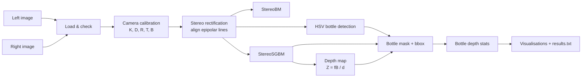
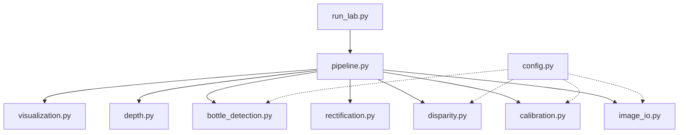
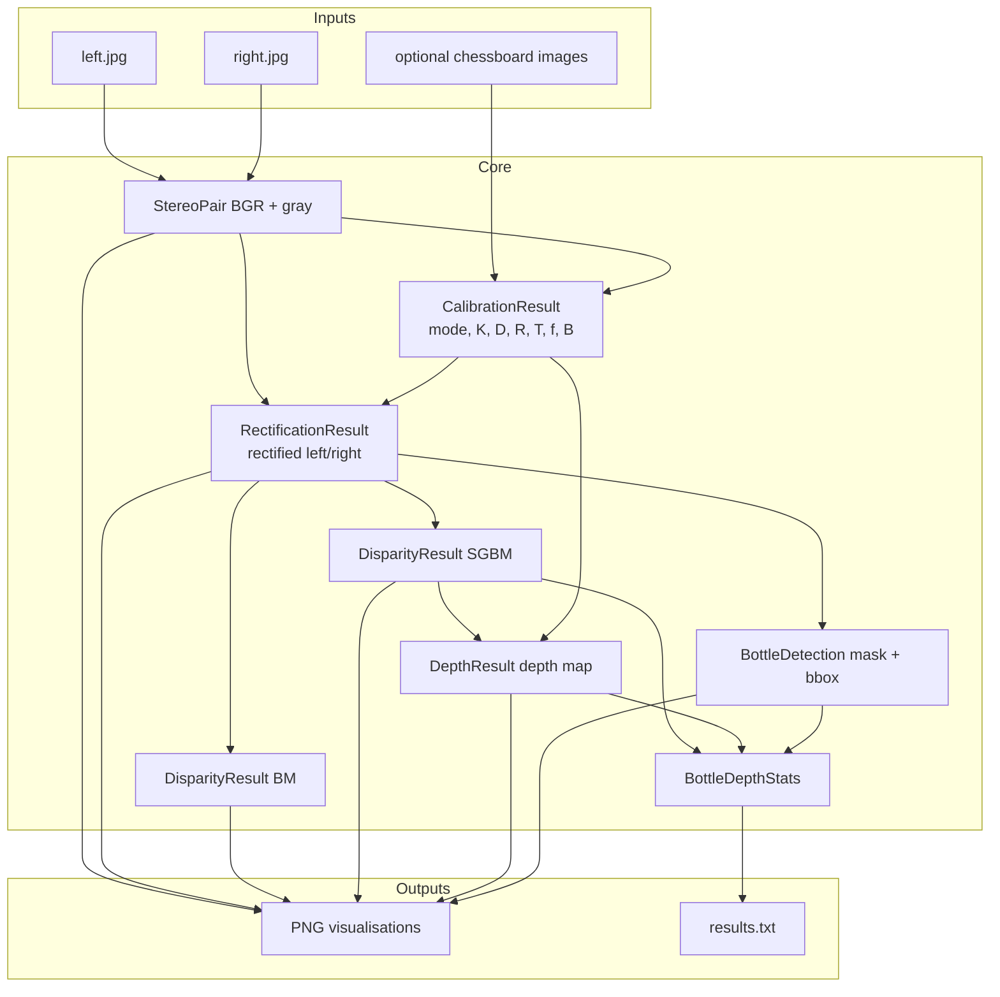
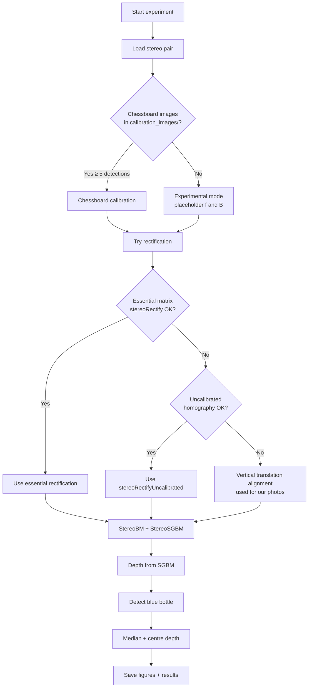

# Computer Vision Lab 2 — Stereo Vision and Depth Estimation

**Goal:** Estimate how far a blue water bottle is from the camera using two photos taken from slightly different positions — using only traditional computer vision (OpenCV, NumPy, Matplotlib). **No deep learning.**

This README is written so you can **understand the full project** and **explain it clearly in front of the class**.

---

## Table of contents

1. [One-minute elevator pitch](#1-one-minute-elevator-pitch)
2. [What problem are we solving?](#2-what-problem-are-we-solving)
3. [System architecture](#3-system-architecture)
4. [Project file structure](#4-project-file-structure)
5. [Step-by-step pipeline (explain each stage)](#5-step-by-step-pipeline-explain-each-stage)
6. [Mathematics you must be able to explain](#6-mathematics-you-must-be-able-to-explain)
7. [How to run the lab](#7-how-to-run-the-lab)
8. [Outputs and what they mean](#8-outputs-and-what-they-mean)
9. [Our actual results](#9-our-actual-results)
10. [Important honesty about calibration](#10-important-honesty-about-calibration)
11. [Class presentation script](#11-class-presentation-script)
12. [Likely viva / Q&A answers](#12-likely-viva--qa-answers)
13. [How to improve accuracy later](#13-how-to-improve-accuracy-later)

---

## 1. One-minute elevator pitch

> Humans see depth because our two eyes look at the world from slightly different places. Close objects shift a lot between the two views; far objects barely shift.  
> We copy that idea with two photos (`left.jpg`, `right.jpg`), measure that shift (**disparity**), and convert it to distance with:

```text
Z = (f × B) / d
```

> Then we detect the blue bottle with colour segmentation and report its depth.

---

## 2. What problem are we solving?

| Item | Details |
|------|---------|
| Input | Two images of the same blue bottle from slightly different camera positions |
| Output | Disparity maps, a depth map, bottle bounding box, and estimated bottle depth |
| Method | Classical stereo vision (calibration → rectification → matching → depth) |
| Libraries | OpenCV, NumPy, Matplotlib |
| Not used | Neural nets, MiDaS, Depth Anything, or any pretrained depth model |

**Why two images?** One photo cannot give true metric depth without extra assumptions. Two views give **parallax**, which is geometric evidence of distance.

---

## 3. System architecture

### 3.1 High-level pipeline



### 3.2 Software architecture (modules)



**Who does what?**

| Module | Responsibility (say this in class) |
|--------|-------------------------------------|
| `run_lab.py` | Command-line entry point |
| `pipeline.py` | Calls every stage in order |
| `image_io.py` | Loads left/right, checks same size, optional resize |
| `calibration.py` | Builds camera matrices; chessboard **or** experimental placeholders |
| `rectification.py` | Makes matching a 1-D horizontal search |
| `disparity.py` | StereoBM + StereoSGBM |
| `depth.py` | Converts disparity to metres with `Z = fB/d` |
| `bottle_detection.py` | Finds the blue bottle and its depth |
| `visualization.py` | Saves all figures and `results.txt` |
| `config.py` | Paths and tuned parameters in one place |

### 3.3 Data-flow architecture



### 3.4 Decision tree inside the code



For **our** photos, aggressive warps were rejected, so the pipeline used **vertical translation alignment** (`dy ≈ 29 px`) — a gentle fix that keeps the bottle upright and preserves horizontal parallax.

---

## 4. Project file structure

```text
CV Lab 2/
├── left.jpg                 # Left camera view
├── right.jpg                # Right camera view
├── run_lab.py               # Main script you run
├── run_lab.bat              # Windows helper launcher
├── requirements.txt         # opencv-python, numpy, matplotlib
├── README.md                # This document
├── calibration_images/      # Put chessboard photos here for real calibration
│   └── README.txt
├── outputs/                 # Created when you run the lab (gitignored)
└── stereo_lab/              # Modular Python package
    ├── __init__.py
    ├── config.py
    ├── image_io.py
    ├── calibration.py
    ├── rectification.py
    ├── disparity.py
    ├── depth.py
    ├── bottle_detection.py
    ├── visualization.py
    └── pipeline.py
```

---

## 5. Step-by-step pipeline (explain each stage)

### Step 1 — Stereo image loading (`image_io.py`)

**What we do**
- Read `left.jpg` and `right.jpg` with OpenCV
- Print shapes and dtypes
- Fail if sizes differ
- Optionally resize (long edge ≤ 800) so the lab runs quickly

**What to say**
> “Stereo algorithms assume both images describe the same scene at the same resolution. We verify that before any geometry.”

---

### Step 2 — Camera calibration (`calibration.py`)

A camera is modelled as a **pinhole camera**:

```text
K = [[fx,  0, cx],
     [ 0, fy, cy],
     [ 0,  0,  1]]
```

| Symbol | Meaning |
|--------|---------|
| `fx`, `fy` | Focal length in **pixels** |
| `cx`, `cy` | Principal point (optical centre in the image) |
| `D` | Distortion coefficients (lens bending) |
| `R` | Rotation of right camera relative to left |
| `T` | Translation of right camera relative to left |
| `B = ‖T‖` | **Baseline** — distance between the two camera centres |

**Two modes**

| Mode | When | Depth meaning |
|------|------|----------------|
| Chessboard | Enough board images in `calibration_images/` | Can be metric if extrinsics are correct |
| **Experimental** | No board images (**our case**) | Demonstrates the formula; **not ground truth** |

**What to say**
> “Without calibration we still run the full pipeline, but we clearly label depths as experimental. We never pretend placeholder `f` and `B` are accurate.”

---

### Step 3 — Stereo rectification (`rectification.py`)

**Why?** Matching in 2-D is hard. After rectification, corresponding points lie on the **same horizontal row**, so search becomes 1-D.

**Methods tried (in order)**
1. Essential matrix + `stereoRectify`
2. Uncalibrated `stereoRectifyUncalibrated`
3. **Fallback used here:** shift the right image vertically by the median feature offset (~29 px)

We draw **green horizontal guide lines** on the rectified pair so you can visually check alignment.

**What to say**
> “Rectification is the cleanup step that makes disparity search reliable.”

---

### Step 4 — Disparity calculation (`disparity.py`)

**Disparity `d`** = how many pixels a scene point moves horizontally between left and right (after rectification).

```text
d = x_left − x_right
```

| Algorithm | Idea | Strength | Weakness |
|-----------|------|----------|----------|
| **StereoBM** | Compare small blocks | Fast | Noisy / holes on smooth surfaces |
| **StereoSGBM** | Semi-global cost aggregation | Cleaner, better edges | Slower |

We use **SGBM** for the final depth. OpenCV returns fixed-point values (`/ 16`). Invalid or `≤ 0` disparities become `NaN`.

For these images, feature matching showed only ~9–16 px of horizontal shift, so `numDisparities` was auto-tuned to **32** (must be a multiple of 16).

**What to say**
> “Closer objects have larger disparity. The bottle’s smooth blue surface is hard to match in the centre, so we rely on valid edge pixels and medians.”

---

### Step 5 — Depth estimation (`depth.py`)

```text
Z = (f × B) / d
```

| Symbol | Unit | Meaning |
|--------|------|---------|
| `Z` | metres | Depth along the camera axis |
| `f` | pixels | Focal length |
| `B` | metres | Baseline |
| `d` | pixels | Disparity |

- Large `d` → small `Z` (near)
- Small `d` → large `Z` (far)
- `d = 0` or missing → skip (no division by zero)

Also convert to centimetres: `cm = m × 100`.

---

### Step 6 — Bottle detection (`bottle_detection.py`)

```text
BGR → HSV → blue/cyan masks → morphology → contours → best bottle-like blob
```

1. Convert to HSV (more stable for colour than RGB)
2. Two ranges: light cyan (upper bottle) + navy (lower bottle / cap)
3. Morphological open/close to remove speckles and fill holes
4. Find contours; prefer a **tall** blob (bottle-like), not a wide floor reflection
5. Draw bounding box, contour, and centroid

---

### Step 7 — Bottle depth calculation

Inside the bottle mask:
- **Median disparity / depth** — robust to outliers
- **Centre disparity / depth** — expanding window around the centroid, keeping only disparities consistent with the bottle median (avoids tiny noisy values on the textureless centre)

---

### Steps 8–10 — Visualise, summarise, save

Every stage is saved under `outputs/`. Numerical summary goes to `results.txt`.

---

## 6. Mathematics you must be able to explain

### 6.1 Similar triangles (intuition)

```text
        Left cam                         Right cam
           O_L -------- baseline B -------- O_R
            \                               /
             \                             /
              \                           /
               \                         /
                \                       /
                 X  (3-D point at depth Z)
```

The same point projects to different image x-coordinates. That difference is disparity `d`.

From similar triangles / pinhole geometry:

```text
d = (f × B) / Z
Z = (f × B) / d
```

### 6.2 Epipolar geometry (short version)

- A point in the left image must lie on a corresponding **epipolar line** in the right image.
- Rectification makes those lines **horizontal and aligned by row**.
- That is why green guide lines are drawn across both rectified images.

### 6.3 Why median instead of mean?

Stereo matching produces outliers (wrong matches). The **median** ignores extreme bad pixels better than the mean — important on a smooth bottle with many invalid centre pixels.

---

## 7. How to run the lab

### Install & run (Windows — recommended Python 3.11 on this PC)

```powershell
& "$env:LocalAppData\Programs\Python\Python311\python.exe" -m pip install -r requirements.txt
& "$env:LocalAppData\Programs\Python\Python311\python.exe" run_lab.py
```

Or double-click `run_lab.bat`.

### Useful flags

```bash
python run_lab.py --show        # pop up Matplotlib windows
python run_lab.py --full-res    # no downscale (slower)
python run_lab.py --left left.jpg --right right.jpg --output outputs
```

### Dependencies

```text
opencv-python
numpy
matplotlib
```

---

## 8. Outputs and what they mean

| File | What it shows | Use it to explain… |
|------|---------------|--------------------|
| `01_original_stereo.png` | Raw left/right | Input pair |
| `02_rectified_stereo.png` | Aligned pair + green lines | Rectification / epipolar geometry |
| `03_disparity_comparison.png` | BM vs SGBM | Matching algorithms |
| `04_colour_mapped_disparity.png` | Colour SGBM map | Disparity as a heat map |
| `05_bottle_detection.png` | BBox + mask | HSV segmentation |
| `06_depth_map.png` | Full depth visualisation | `Z = fB/d` |
| `07_bottle_depth.png` | Bottle overlay + depth text | Final answer for the bottle |
| `results.txt` | Numbers | Lab report / viva numbers |

---

## 9. Our actual results

From the last successful run (`outputs/results.txt`):

| Quantity | Value |
|----------|-------|
| Working resolution | 600 × 800 (scaled 0.5 from 1201 × 1600) |
| Calibration mode | **experimental** |
| Focal length `f` | 700 px (placeholder) |
| Baseline `B` | 0.08 m (placeholder) |
| Bottle bbox `(x,y,w,h)` | `(224, 164, 103, 367)` |
| Centroid | `(280, 350)` |
| Median disparity | **13.0 px** |
| Centre disparity | **12.375 px** |
| Median depth | **~4.29 m (428.7 cm)** — illustrative |
| Centre depth | **~4.53 m (452.5 cm)** — illustrative |

**Say this clearly in class:**  
> “These metre values demonstrate the stereo equation with assumed `f` and `B`. They are not surveyed ground-truth distances.”

---

## 10. Important honesty about calibration

We **do not invent “accurate” camera parameters**.

Without chessboard calibration + a measured baseline, metric depth is only as good as the placeholders in `config.py`:

```python
EXPERIMENTAL_FOCAL_PX = 700.0
EXPERIMENTAL_BASELINE_M = 0.08
```

**To get accurate metres you need:**
1. Many chessboard images → intrinsics `K`, `D`
2. Simultaneous left/right board views → `cv2.stereoCalibrate` → `R`, `T`
3. A physically measured baseline `B`
4. Then true metric `Z = fB/d`

Put board photos in `calibration_images/` to enable the chessboard path.

---

## 11. Class presentation script

Use this as a speaking outline (~5–8 minutes).

### Opening (30 sec)
> “Lab 2 is stereo vision. Like two eyes, two cameras give parallax. We convert that parallax into depth for a blue bottle using classical OpenCV — no neural networks.”

### Architecture (1 min)
> Show the pipeline diagram: load → calibrate → rectify → disparity → depth → detect bottle → report depth.  
> “The code is modular so each concept maps to one file.”

### Live or saved outputs (3 min)
1. Original pair — same scene, small viewpoint change  
2. Rectified pair — green lines prove row alignment  
3. BM vs SGBM — SGBM denser / cleaner  
4. Bottle mask — HSV colour segmentation  
5. Final depth overlay — formula applied inside the mask  

### Math slide (1 min)
> Write `Z = fB/d` on the board. Explain each symbol. Mention similar triangles.

### Closing (30 sec)
> “Pipeline works end-to-end. Because we lack chessboard calibration, depths are experimental. With real calibration, the same code gives metric depth.”

---

## 12. Likely viva / Q&A answers

**Q: Why rectify?**  
A: So correspondence search is horizontal only; epipolar lines become scanlines.

**Q: BM vs SGBM?**  
A: BM compares local blocks. SGBM aggregates matching costs along many paths → smoother, more accurate maps. We use SGBM for final depth.

**Q: Why is the bottle centre often black in disparity?**  
A: The surface is smooth / low texture, so block matching finds weak matches. We use median over valid mask pixels and an expanding centre window.

**Q: Why HSV not RGB?**  
A: Hue separates colour from brightness; lighting changes hurt RGB thresholds more.

**Q: What if left/right were swapped?**  
A: Disparity would go negative / invalid for front objects. We verified `x_left − x_right > 0`.

**Q: Are your depths correct in metres?**  
A: They follow the formula with experimental `f` and `B`. They are illustrative until real calibration and measured baseline are provided.

**Q: Why median disparity?**  
A: Robust to outlier matches.

**Q: What is baseline?**  
A: Distance between the two camera centres. Larger baseline → larger disparity for the same depth → better depth resolution, but harder matching if too large.

---

## 13. How to improve accuracy later

1. Capture 15–20 chessboard poses → real `K`, `D`  
2. Capture stereo chessboard pairs → real `R`, `T`, `B`  
3. Measure baseline with a ruler  
4. Use `--full-res` after calibration  
5. Optionally add a known-size object to cross-check `Z`  
6. Tune HSV if lighting changes  

---

## Quick formula card (print this)

```text
Disparity:   d = x_left - x_right          (pixels)
Depth:       Z = (f * B) / d               (metres)
Baseline:    B = ||T||                     (metres)
Focal:       f ≈ fx from camera matrix K   (pixels)

Closer object  →  larger d  →  smaller Z
Farther object →  smaller d →  larger Z
```

---

## Credits / stack

- **Language:** Python 3  
- **Libraries:** OpenCV, NumPy, Matplotlib  
- **Topic:** Stereo Vision & Depth Estimation  
- **Approach:** Traditional multi-view geometry only  

Good luck with your class explanation — walk the diagrams top-to-bottom, then show the `outputs/` images in order `01` → `07`.
