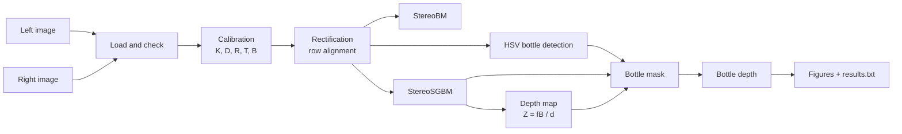
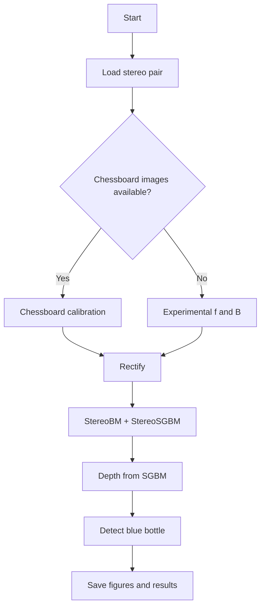

# Computer Vision Lab 2 — Stereo Vision and Depth Estimation

**Goal:** Estimate how far a blue water bottle is from the camera using two photos taken from slightly different positions. The whole experiment uses traditional computer vision only: **OpenCV**, **NumPy**, and **Matplotlib**. There is no deep learning and no pretrained depth model.

All of the code lives in one file: **`run_lab.py`**. This README explains the project in depth so you can learn the ideas and explain them clearly.

---

## Table of contents

1. [What this project is about](#1-what-this-project-is-about)
2. [Why stereo vision works](#2-why-stereo-vision-works)
3. [System architecture](#3-system-architecture)
4. [Project files](#4-project-files)
5. [The full pipeline explained](#5-the-full-pipeline-explained)
6. [Mathematics in depth](#6-mathematics-in-depth)
7. [Algorithms used](#7-algorithms-used)
8. [How to run](#8-how-to-run)
9. [Outputs explained](#9-outputs-explained)
10. [Our results](#10-our-results)
11. [Calibration honesty](#11-calibration-honesty)

---

## 1. What this project is about

This lab answers a simple question: **how far is the blue bottle from the camera?**

A single photograph is only a flat 2-D projection of a 3-D world. From one image alone, you cannot recover true metric distance without strong extra assumptions. Stereo vision solves this by using **two images** of the same scene captured from slightly different positions, just like human eyes.

In this project the two images are `left.jpg` and `right.jpg`. Both show the same indoor scene and the same blue water bottle, but the camera moved a little between shots. That tiny change in viewpoint creates **parallax**: nearby objects appear to shift more between the two photos than distant objects do. The code measures that shift (called **disparity**) and converts it into depth using the stereo formula:

```text
Z = (f × B) / d
```

After the depth map is computed, the code finds the blue bottle with colour segmentation and reports the bottle’s estimated depth in metres and centimetres.

| Item | Details |
|------|---------|
| Input | `left.jpg`, `right.jpg` |
| Output | Disparity maps, depth map, bottle bbox, bottle depth, figures, `results.txt` |
| Method | Classical stereo pipeline |
| Libraries | OpenCV, NumPy, Matplotlib |
| Not used | Neural nets / MiDaS / Depth Anything / any pretrained depth model |

---

## 2. Why stereo vision works

Imagine holding one finger in front of your face and alternately closing each eye. The finger jumps sideways a lot. Now look at a far wall and do the same thing: the wall barely moves. That sideways jump is parallax, and it is larger when the object is closer.

Stereo cameras (or two photos) create the same effect. After the images are properly aligned, a 3-D point appears at column `x_left` in the left image and column `x_right` in the right image. The difference:

```text
d = x_left − x_right
```

is the **disparity**. Close objects have large `d`. Far objects have small `d`.

If you also know:

- `f` — focal length in pixels  
- `B` — baseline, the distance between the two camera centres in metres  

then geometry gives depth:

```text
Z = (f × B) / d
```

That single equation is the heart of this lab. Everything else in the code exists to make `d` reliable and to apply the formula only where the bottle is.

---

## 3. System architecture

### 3.1 High-level pipeline

The experiment always follows the same order. Each stage prepares data for the next one.



In words: load the pair → get camera geometry → align the images → compute disparity with two matchers → turn disparity into depth → detect the bottle → measure depth inside the bottle → save everything.

### 3.2 What is inside `run_lab.py`

The project used to be split across many modules. It is now **one file** so it is easier to read and submit. Inside `run_lab.py` the sections are:

| Section | What it does |
|---------|----------------|
| Config constants | Paths, experimental `f` and `B`, stereo parameters, HSV ranges |
| Image loading | Reads left/right, checks sizes, optional resize |
| Calibration | Chessboard path or experimental placeholders |
| Rectification | Tries several ways to make epipolar lines horizontal |
| Disparity | Runs StereoBM and StereoSGBM |
| Depth | Applies `Z = (f * B) / d` safely |
| Bottle detection | HSV mask, morphology, contours, depth stats |
| Visualisation | Writes PNG figures and `results.txt` |
| `main()` | Command-line entry point |

### 3.3 Decision flow



For our bottle photos, strong geometric warps were rejected because they damaged the image too much. The working method was a gentle **vertical translation** that removes the ~29 px vertical offset while keeping horizontal parallax intact. If feature matching suggests the left/right naming is swapped (negative disparity trend), the code swaps them for matching so OpenCV gets the expected positive disparity direction.

---

## 4. Project files

```text
CV Lab 2/
├── left.jpg              # one view of the bottle
├── right.jpg             # second view from a slightly different position
├── run_lab.py            # entire implementation
├── run_lab.bat           # optional Windows launcher
├── requirements.txt      # opencv-python, numpy, matplotlib
├── README.md             # this learning document
├── calibration_images/   # optional chessboard photos for real calibration
└── outputs/              # created when you run the lab (gitignored)
```

---

## 5. The full pipeline explained

### Step 1 — Loading the stereo pair

The program reads both images with OpenCV and prints their shapes and data types. This is not just bookkeeping. Stereo algorithms assume that both images cover the same scene at the same resolution. If the widths or heights differ, correspondence becomes meaningless, so the code stops with an error.

For speed during demos, the long edge is optionally limited to 800 pixels. That preserves enough detail for block matching while making StereoSGBM much faster on a laptop. You can disable resizing with `--full-res` if you want native resolution.

### Step 2 — Camera calibration

A digital camera is modelled as a pinhole camera. The **intrinsic matrix** `K` stores focal length in pixels (`fx`, `fy`) and the principal point (`cx`, `cy`), which is roughly the image centre:

```text
K = [[fx,  0, cx],
     [ 0, fy, cy],
     [ 0,  0,  1]]
```

Real lenses also bend light, so we keep **distortion coefficients** `D`. For two cameras we also need **extrinsics**: a rotation `R` and translation `T` that describe how the right camera is posed relative to the left. The length of `T` is the **baseline** `B`.

There are two modes:

- **Chessboard mode** — if enough board images exist in `calibration_images/`, OpenCV estimates real intrinsics.
- **Experimental mode** — our current case. No board images are present, so the code uses clearly labelled placeholder values (`f ≈ 700 px`, `B ≈ 0.08 m`). The pipeline still runs end-to-end, but the resulting metres are for demonstrating the equation, not claiming surveyed ground truth.

This honesty matters in a lab evaluation. It is better to say “experimental depth” than to invent fake accuracy.

### Step 3 — Stereo rectification

Before disparity matching, the two images should be arranged so that a point in the left image has its match somewhere on the **same row** in the right image. That property comes from epipolar geometry. Rectification warps the images until epipolar lines become horizontal scanlines.

Searching for matches in full 2-D is slow and ambiguous. After rectification, search becomes one-dimensional: for each pixel, slide only left and right along its row.

The code tries, in order:

1. Essential-matrix pose recovery + calibrated `stereoRectify`
2. Uncalibrated homography rectification
3. Simple vertical translation using the median feature y-offset

Methods 1 and 2 were too aggressive on these hand-held phone photos and were rejected by sanity checks. Method 3 kept the bottle upright and preserved the useful horizontal shift. Green guide lines are drawn across the side-by-side rectified pair so you can visually confirm row alignment.

### Step 4 — Disparity calculation

Disparity is the measured horizontal shift after rectification. The lab computes it twice for comparison.

**StereoBM (Block Matching)** takes a small window around a pixel in the left image and searches for the most similar window on the same row in the right image. It is fast and easy to understand, but it struggles on smooth or repetitive regions because many windows look alike.

**StereoSGBM (Semi-Global Block Matching)** also compares blocks, but then aggregates matching costs along many paths across the image. That global-ish consistency usually produces denser and cleaner maps, especially around object boundaries. This is why **SGBM is used for the final depth**.

OpenCV returns disparities in a fixed-point format that must be divided by 16 to get pixel units. Invalid or non-positive values are marked as NaN so they never enter the depth formula. On this dataset the observed parallax is only about 9–16 pixels, so `numDisparities` is auto-tuned to 32 (OpenCV requires a multiple of 16).

One practical issue: the bottle surface is smooth blue paint with little texture. Matching often fails in the bottle centre, leaving black holes in the disparity map. That is expected, not a total failure. Later we use medians over valid pixels inside the bottle mask.

### Step 5 — Depth estimation

Once disparity is available, depth follows directly from similar triangles in the pinhole model:

```text
Z = (f × B) / d
```

If disparity is large, the object is close, so `Z` is small. If disparity is tiny, the object is far, so `Z` is large. The code never divides by zero: pixels with missing or non-positive disparity stay invalid. Extremely huge or tiny depths are also rejected as numerical junk.

Depth is stored in metres and also reported in centimetres (`cm = m × 100`) for the final bottle summary.

### Step 6 — Bottle detection

We do not use an object detector network. The bottle is found by colour.

First the image is converted from BGR to **HSV**. In HSV, hue roughly means “which colour”, while value means brightness. That makes blue thresholds more stable when lighting changes. Two hue ranges are used because the bottle is two-tone: bright cyan on top and navy below.

The binary mask is cleaned with morphological opening and closing. Opening removes speckles; closing fills small holes. Contours are then extracted, and the code prefers a tall, bottle-like blob rather than a wide blue reflection on the floor. The chosen contour becomes the bottle mask, bounding box, and centroid.

### Step 7 — Bottle-specific depth

The full depth map covers the whole room. For the lab answer we care about the bottle only.

All valid disparity and depth pixels inside the bottle mask are collected. The **median** is used instead of the mean because stereo matching creates outliers, and the median is robust to them. For the bottle centre, the code expands a window around the centroid until it finds enough plausible disparities. Tiny noisy disparities that are inconsistent with the bottle’s median are ignored. This handles the textureless centre problem without inventing fake matches.

### Steps 8–10 — Visualisation and reporting

Every important stage is saved as an image under `outputs/`. A plain-text `results.txt` stores the numerical summary: bounding box, centroid, disparities, baseline, focal length, and estimated depths. That file is what you can paste into a lab report.

---

## 6. Mathematics in depth

### 6.1 Similar triangles

```text
        Left cam                         Right cam
           O_L -------- baseline B -------- O_R
            \                               /
             \                             /
              \                           /
               \                         /
                \                       /
                 X  (3-D point at depth Z)
```

A point `X` at depth `Z` projects into both images. Because the cameras are separated by baseline `B`, the projected x-coordinates differ. With focal length `f` in pixels, the relationship is:

```text
d = (f × B) / Z
Z = (f × B) / d
```

This is the same geometry that appears in textbooks under “stereo triangulation” or “binocular disparity”.

### 6.2 Intrinsics and extrinsics

- **Intrinsics (`K`, `D`)** describe one camera by itself: zoom-like focal length, image centre, lens distortion.
- **Extrinsics (`R`, `T`)** describe the relationship between the two cameras.
- **Baseline `B`** is the distance between camera centres. Larger baseline usually improves depth precision for a given scene, but if `B` is too large, matching becomes harder because the views differ too much.

### 6.3 Epipolar geometry

A point chosen in the left image cannot appear anywhere in the right image. It must lie on a corresponding **epipolar line**. Rectification is the process of warping both images so those lines become horizontal and row-aligned. After that, disparity search is simply “look along this row”.

### 6.4 Why median depth

Mean depth can be ruined by a few wildly wrong matches. Median depth asks: “what depth do most valid bottle pixels agree on?” That is much more stable for a lab measurement on a partially matched object.

---

## 7. Algorithms used

If someone asks “what algorithm did you use?”, answer with this list:

1. **StereoSGBM** — main disparity algorithm for final depth  
2. **StereoBM** — classical block matching, kept for comparison  
3. **ORB feature matching + RANSAC** — finds correspondences for rectification geometry  
4. **Essential / fundamental matrix methods** — attempted geometric rectification  
5. **Vertical translation alignment** — practical rectification used on these photos  
6. **HSV colour segmentation + morphology + contours** — bottle detection  
7. **Pinhole stereo equation `Z = fB/d`** — depth from disparity  

The most important name for the depth answer is **StereoSGBM**.

---

## 8. How to run

### Windows (Python 3.11 on this machine)

```powershell
& "$env:LocalAppData\Programs\Python\Python311\python.exe" -m pip install -r requirements.txt
& "$env:LocalAppData\Programs\Python\Python311\python.exe" run_lab.py
```

Or double-click `run_lab.bat`.

### Useful options

```bash
python run_lab.py --show
python run_lab.py --full-res
python run_lab.py --left left.jpg --right right.jpg --output outputs
```

### Dependencies

```text
opencv-python
numpy
matplotlib
```

After a successful run, open the `outputs/` folder. That folder is gitignored because the images can always be regenerated by running the script again.

---

## 9. Outputs explained

| File | What you are looking at | Why it matters |
|------|-------------------------|----------------|
| `01_original_stereo.png` | Raw left and right photos | Shows the input parallax pair |
| `02_rectified_stereo.png` | Aligned images with green rows | Proves rectification / epipolar alignment |
| `03_disparity_comparison.png` | BM vs SGBM | Shows why SGBM is preferred |
| `04_colour_mapped_disparity.png` | Colour SGBM disparity | Visual disparity field |
| `05_bottle_detection.png` | Bounding box and mask | Shows colour segmentation worked |
| `06_depth_map.png` | Depth visualisation | Result of `Z = fB/d` |
| `07_bottle_depth.png` | Bottle overlay with depth text | Final lab answer view |
| `results.txt` | Numbers | Report / evaluation summary |

Read the figures in order from `01` to `07` while explaining. That order matches the pipeline.

---

## 10. Our results

From a successful run on the provided bottle pair:

| Quantity | Value |
|----------|-------|
| Working resolution | 600 × 800 (scaled from 1201 × 1600) |
| Calibration mode | experimental |
| Focal length `f` | 700 px (placeholder) |
| Baseline `B` | 0.08 m (placeholder) |
| Bottle bbox `(x, y, w, h)` | `(224, 164, 103, 367)` |
| Centroid | `(280, 350)` |
| Median disparity | 13.0 px |
| Centre disparity | 12.375 px |
| Median depth | about 4.29 m (428.7 cm) |
| Centre depth | about 4.53 m (452.5 cm) |

These depths correctly follow the stereo equation with the assumed `f` and `B`. They are **illustrative**, not measured ground truth. If the true baseline were smaller or larger, every metre value would scale with it.

---

## 11. Calibration honesty

This project does **not** pretend placeholder camera parameters are accurate.

At the top of `run_lab.py`:

```python
EXPERIMENTAL_FOCAL_PX = 700.0
EXPERIMENTAL_BASELINE_M = 0.08
```

To obtain trustworthy metric depth you would need:

1. Many chessboard images to estimate intrinsics `K` and `D`
2. Simultaneous left/right chessboard views for `cv2.stereoCalibrate` to recover `R` and `T`
3. A physically measured baseline `B`
4. Then the same formula `Z = fB/d` with real numbers

Put chessboard photos in `calibration_images/` if you want to enable that path later. Until then, always label the depths as experimental when you present the lab.

---

## Quick formula reminder

```text
Disparity:  d = x_left - x_right
Depth:      Z = (f * B) / d
Baseline:   B = distance between camera centres
Focal:      f = focal length in pixels

Closer object  -> larger d -> smaller Z
Farther object -> smaller d -> larger Z
```
