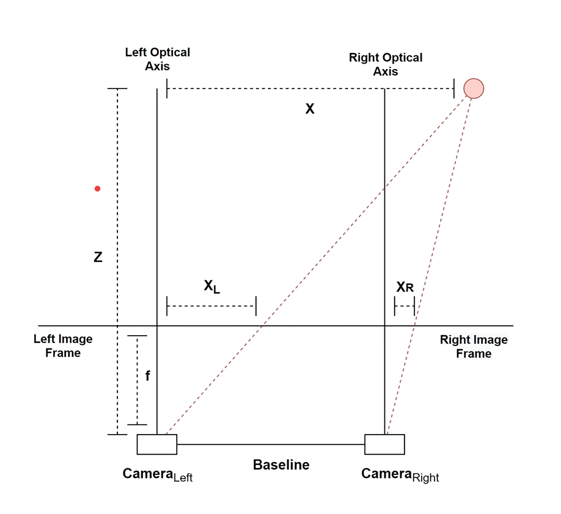
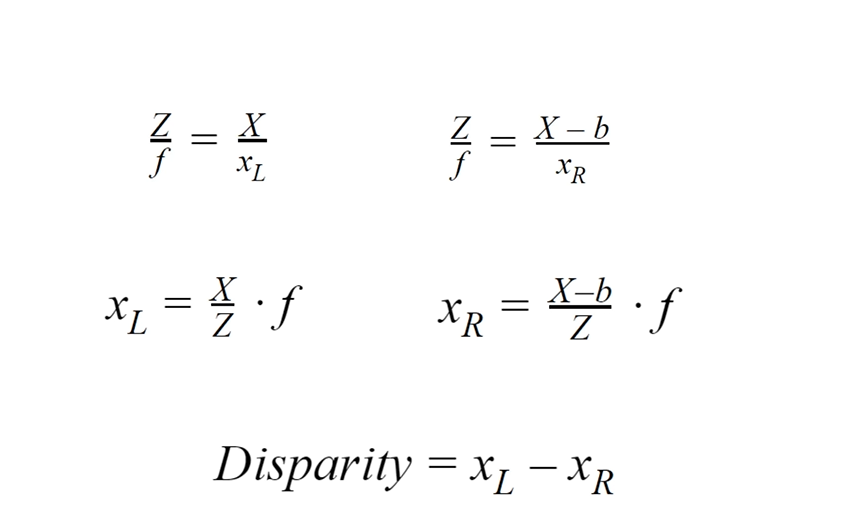

# Computer Vision Lab 2 — Stereo Vision & Depth Estimation

Classical stereo pipeline in one file: **`run_lab.py`**  
Stack: **OpenCV · NumPy · Matplotlib** (no deep learning)

Left and right photos were captured with a **POCO X6 Pro 5G** main (wide) camera by shifting the phone sideways around a fixed centre.

---

## Capture setup (phone calibration)

| Parameter | Value | Notes |
|-----------|-------|--------|
| Device | POCO X6 Pro 5G | Main / wide lens |
| 35 mm equivalent focal length | **25 mm** | Manufacturer / EXIF class value |
| Physical move | 6 cm left + 6 cm right of centre | Handheld horizontal baseline |
| Baseline `B` | **12 cm** | Total optical-centre separation |
| Pixel focal length | `f = (25 × W) / 36` | `W` = image width in pixels |

For the checked-in pair (`1201 × 1600`):

```text
f ≈ (25 × 1201) / 36 ≈ 834 px
B = 12 cm
```

Depth is reported in **centimetres** so it matches `B` in cm:

```text
Z = (f · B) / d
```

---

## Stereo triangulation (geometry)



How the diagram maps to **our** values:

| Symbol in diagram | Meaning | Value used in this lab |
|-------------------|---------|------------------------|
| Baseline | Distance between left & right camera centres | **B = 12 cm** (6 cm left + 6 cm right of centre) |
| `f` | Focal length in **pixels** | **f ≈ 834 px** via `(25 × W) / 36`, `W = 1201` |
| `X_L`, `X_R` | Horizontal image positions of the same 3-D point | Measured after rectification / matching |
| Disparity `d` | `d = X_L − X_R` (horizontal pixel shift) | From **StereoSGBM** (`disparity_map.npy`) |
| `Z` | Depth from the cameras to the point | **Z = (f · B) / d** → e.g. bottle ≈ **85.5 cm** |

```text
Z = (f · B) / (X_L − X_R) = (f · B) / d

Example (median bottle region):
  f ≈ 834 px,  B = 12 cm,  d ≈ 115 px
  Z ≈ (834 × 12) / 115 ≈ 87 cm   (measured median ≈ 85.5 cm)
```

### Projection & disparity equations



| Equation | Meaning | Our lab values |
|----------|---------|----------------|
| `Z / f = X / x_L` | Similar triangles (left camera) | `f ≈ 834 px` |
| `Z / f = (X − b) / x_R` | Similar triangles (right camera) | `b = B = 12 cm` |
| `x_L = (X / Z) · f` | Left image coordinate of the 3-D point | From left view |
| `x_R = ((X − b) / Z) · f` | Right image coordinate | From right view |
| `Disparity = x_L − x_R` | Horizontal pixel shift `d` | StereoSGBM output |

Eliminating `X` from the two projection equations gives the depth we use in code:

```text
d = x_L − x_R
Z = (f · b) / d = (f · B) / d
```

---

## Pipeline

```text
Input: left.jpg + right.jpg
   │
   ▼
SIFT  — detect keypoints & descriptors on both images
   │
   ▼
Brute-Force matching (L2)  — pair left↔right descriptors
   │
   ▼
RANSAC Homography  — reject bad matches; warp right onto left rows
   │
   ▼
StereoSGBM  — dense disparity map d (horizontal pixel shift)
   │
   ▼
Triangulation  Z = (f · B) / d
   │
   ▼
Outputs: disparity / depth images + .npy arrays + bottle distance
```

---

## Algorithms (what each step does)

### 1. SIFT (Scale-Invariant Feature Transform)
Finds distinctive points (corners, textured spots) that survive small tilt, scale, and lighting changes from handheld capture.

### 2. Brute-Force matching
Compares every left SIFT descriptor to every right descriptor (L2 distance) and keeps the best pairs.  
**Use:** builds the left↔right correspondences that Homography needs. It is *not* the dense depth matcher.

### 3. RANSAC Homography
Fits a warp `H` that maps the right image onto the left image plane, while discarding geometric outliers.  
**Use:** corrects small handheld tilt/height error so stereo search can run along horizontal rows.

### 4. StereoSGBM (Semi-Global Block Matching)
For each pixel in the left image, slides a window along the same row in the right image and finds the best match. Output is the **disparity map** `d` (pixels).

### 5. Triangulation
Converts disparity into metric depth with the phone baseline and focal length:

```text
d = u_left − u_right          # disparity (px)
Z = (f · B) / d               # depth (cm)
```

Closer objects → larger `d` → smaller `Z`.

---

## How to run

```powershell
& "$env:LocalAppData\Programs\Python\Python311\python.exe" -m pip install -r requirements.txt
& "$env:LocalAppData\Programs\Python\Python311\python.exe" run_lab.py
```

Optional flags:

```bash
python run_lab.py --show                 # open figure windows
python run_lab.py --baseline-cm 12       # default B
python run_lab.py --max-edge 800         # faster downscaled preview
```

Place your stereo pair as `left.jpg` and `right.jpg` in the repo root (or pass `--left` / `--right`).

---

## Outputs (`outputs/`)

| File | Description |
|------|-------------|
| `01_stereo_pair.png` | Input left / right |
| `01b_sift_ransac_matches.png` | SIFT + RANSAC inlier matches |
| `02_rectified_scanlines.png` | Left + Homography-aligned right |
| `03_target_roi.png` | Bottle ROI with measured distance |
| `04_disparity_gray.png` | Disparity (brighter = larger `d` = closer) |
| `05_disparity_color.png` | Colour disparity |
| `06_depth.png` / `output_depth_map.png` | Depth colormap (warm = near) |
| `output_disparity.png` | Raw disparity preview |
| `output_rectified_right.png` | Aligned right image |
| `disparity_map.npy` | Disparity array (px) |
| `depth_map_cm.npy` | Depth array (cm) |
| `results.txt` | Calibration numbers + bottle distance |

Example result from the current pair (see `results.txt`):

```text
f_pixel ≈ 834 px
B = 12 cm
RANSAC inliers ≈ 76 / 100
Measured bottle distance ≈ 85.5 cm
```

---

## Project layout

```text
ComputerVision-Lab2/
├── left.jpg / right.jpg     # stereo pair
├── run_lab.py               # full pipeline
├── requirements.txt
├── README.md
└── outputs/                 # generated (gitignored visuals/arrays)
```

---

## Limitations

- Handheld shift is not a perfect parallel stereo rig; Homography helps but residual error remains.
- Textureless walls / floors often have missing or noisy disparity.
- Absolute centimetre accuracy improves further with chessboard `stereoCalibrate`; this lab uses the phone parameters above (`B = 12 cm`, `f = 25·W/36`).
